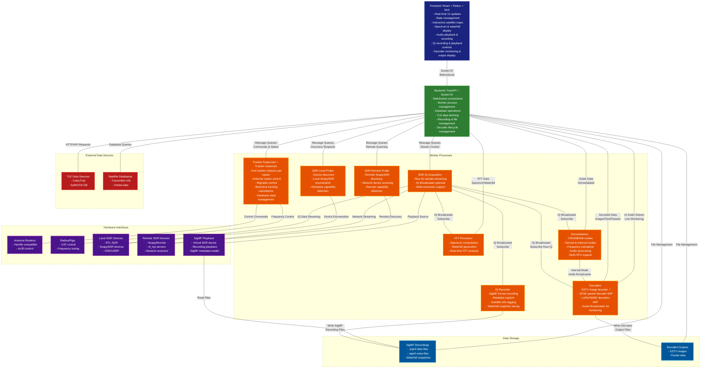
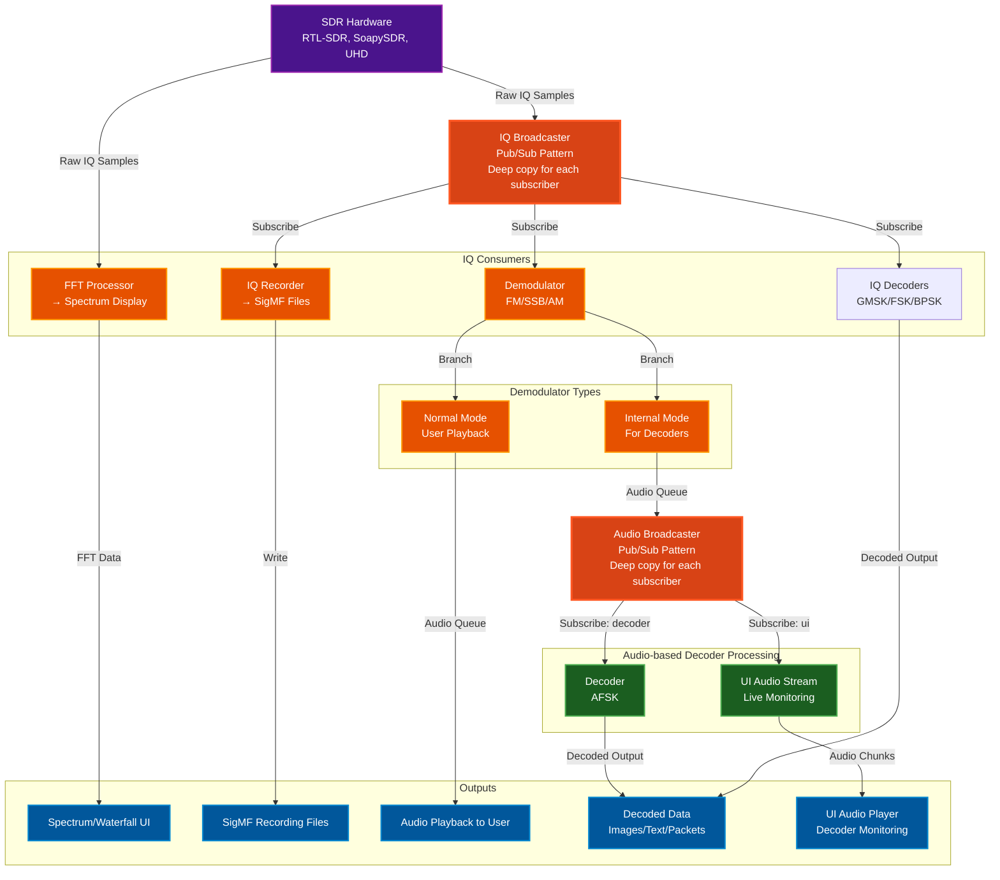

# Ground Station

[](https://github.com/sgoudelis/ground-station/actions/workflows/tests.yml) [](https://www.gnu.org/licenses/gpl-3.0) [](https://github.com/sgoudelis/ground-station/actions/workflows/release-from-images.yml) [](https://github.com/sgoudelis/ground-station/releases/latest) [](https://github.com/sgoudelis/ground-station/commits/main) [](https://github.com/sponsors/sgoudelis)


**Ground Station is an open-source, browser-based application for tracking satellites and celestial targets,
controlling station hardware, and receiving, decoding, and recording SDR signals.** Built for amateur radio
operators, satellite enthusiasts, and researchers, it brings orbit visualization, multi-target tracking consoles,
SDR waterfall analysis, packet and telemetry decoding, scheduled observations, and hardware management into a
single web interface.

## Recent Releases

* **v0.8.24 (2026-10-30):** This release adds scheduler observation conflict detection that validates shared hardware time across the observation form, satellite selector, and pass selector, plus new packet decoding, telemetry parsing, and housekeeping views with RS18S support in the USP parser. Numeric decoder parameters gain range-validated input fields, toolbar actions adapt to available space with a new responsive button, and artifact dates now consistently prefer capture time across the backend and file browser. Saved satellites and transmitters load reliably by NORAD ID despite autocomplete limits, with expanded test coverage for satellite search, scheduling validation, and decoder workflows.
* **v0.8.23 (2026-10-29):** SSTV decoding is now far more robust, with new tone detection and audio resampling, and decoded images open in a reusable image viewer that works across decoded files. Satellite deletion now preserves the catalogs, groups, and schedules it shares with others, and the monitored satellite dialog falls back to option labels when translations are missing. The map re-centers on the selected position while following, solar-system scrolling no longer moves the page, and the decoded-packets drawer and file browser dialogs now scale with the viewport.
* **v0.8.22 (2026-10-26):** Added LASARSAT AX.25 beacon decoding with viewer support. Satellite tracking gained observer-context updates, rotator and image-handling improvements, live navigation status indicators, and command expiration with backend epoch tracking. Earth View added map title controls for fullscreen and home centering with steadier globe fitting, and the reorganized VFO panel improves filtering and readability. LoRa decoded packets now show satellite links and refined callsign hints, while connection popovers and traffic statistics render more responsively.
* **v0.8.21 (2026-10-25):** Added live and scheduled LoRa decoding with configurable receiver profiles, dynamic VFO controls, and TinyGS transmitter data in orbital synchronization. Earth View and satellite tracking now support OMM orbit propagation, and UMKA-1 USP telemetry is decoded into readable engineering values. Recording views gained transmitter frequency markers and waterfall-generation progress, while the file browser gained observation and type filters with more reliable paging. Satellite and transmitter editing, VFO transmitter locking, and scheduler dialogs also received clearer controls and responsiveness improvements.
* **v0.8.20 (2026-10-20):** Ground Station has gained a documented public API with scoped access tokens, live event streams, and artifact downloads. Transcription now supports Parakeet, with Google Translate and LibreTranslate options. GNSS updates improve tuning guidance, pseudorange data, and fix handling, while transmitter settings add FSK framing and deviation controls. Observation scheduling now supports rig selection and clearer conflict choices; the file browser adds a purge preview. This update also improves SDR error reporting and lets Docker deployments configure the Nginx HTTP port with GS_HTTP_PORT.
* **v0.8.19 (2026-10-11):** Expanded Simplified Chinese coverage across the current interface and made many previously hardcoded labels, prompts, tooltips, and status messages translatable. Added guidance for extending other language packs and corrected satellite service filtering so translated labels select the right data.
* **v0.8.18 (2026-10-08):** Added the ability to join a live SDR stream with independent VFOs, plus improved device capability detection and controls for taking over shared SDR settings. Satellite views now show live positions and future passes, offer quicker access to recent groups, and provide more actions from pass tables. Maintenance gained release status and Docker update guidance. Voice squelch now rejects hiss more effectively, with a longer adjustable close delay and smoother FM demodulation.
* **v0.8.17 (2026-10-06):** This release substantially improves interface responsiveness with incremental rendering of maps and dashboard panels, batched live-data updates, fewer unnecessary frame callbacks, and smoother VFO interactions. It also adds synchronized VFO audio controls, richer observation and decoded-file management, improved SatDump failure recovery, and refinements to waterfall, rotator, targeting, and Solar System displays.
* **v0.8.16 (2026-09-30):** This release expands satellite catalog management with dedicated orbital-data pages, lifecycle timestamps, improved search, filtering, pagination, and table layouts. It also refines the celestial catalog and Solar System display with clearer object labels and an option to hide labels for unfocused objects, improves waterfall decoded-packet and observation asset links, and includes reliability improvements for setup-wizard logout handling.
* **v0.8.15 (2026-09-29):** Added vector coverage details and unified property editing across celestial target context menus; improved celestial-pass pagination as results change; and optimized Earth trajectory caching with minimal non-dominated projections, duplicate-free canonical target updates, and clearer synchronization progress.

## Screenshots

<div align="center">

### Global Satellite Overview
<p>
  
  &nbsp;&nbsp;&nbsp;
  
</p>

*Overview page with quick group selection and real-time satellite status indicators*

---

### Solar System View
<p>
  
  &nbsp;&nbsp;&nbsp;
  
</p>

*Solar System page for celestial-body tracking with live orbital context and interactive visualization*

---

### Login Screen
<p>
  
  &nbsp;&nbsp;&nbsp;
  
</p>

*Login screen for user authentication before accessing the Ground Station interface*

---

### Multi-Target Tracking Console
<p>
  
  &nbsp;&nbsp;&nbsp;
  
</p>

*Multi-target tracking console view showing an active ISS target with per-target control and live tracking telemetry*

---

### SDR Waterfall View


*Waterfall view with live transcription overlay during active satellite communication*

---

### Waterfall Packet Decoding (GMSK)


*Waterfall view receiving GMSK and decoding with two VFOs*

---

### Telemetry Packet Viewer (Hex + ASCII)


*Packet viewer showing telemetry payload bytes in hex with ASCII side-by-side*

---

### TLE Data Synchronization


*TLE synchronization page showing real-time progress and satellite database updates*

---

### SDR Hardware Management


*Comprehensive SDR device management interface supporting RTL-SDR, SoapySDR, and UHD/USRP radios with remote capability*

---

### File Browser & Decoders


*File browser view showing decoded weather images, packet outputs, and saved transcriptions*

---

### Observations Overview


*Automated observations dashboard with upcoming passes and task status*

---

### DSP Topology & Performance


*Chain of threads and processes IQ samples pass through, showing performance and data flow across the DSP pipeline*

---

</div>

## Key Features

*   **Real-time Orbit Tracking:** Track Earth-orbiting targets using Skyfield/SGP4 propagation from stored orbital elements.
*   **Configurable Orbital Sources + Metadata Enrichment:** Sync orbital data from configured sources (default CelesTrak feeds) and enrich satellites/transmitters from SatNOGS APIs.
*   **Multi-Target Tracker Instances:** Run multiple tracker instances in parallel (`target-N` slots), each with independent runtime state.
*   **Automated Antenna Rotator Control:** Drive connected rotators with continuous az/el updates, limit checks, and anti-thrashing retarget logic.
*   **Rig Control with Doppler Correction:** Control compatible rigs (rigctld/Hamlib paths) with RX/TX Doppler-corrected tuning during tracking.
*   **SDR Hardware Support:** RTL-SDR (USB/rtl_tcp), MiriSDR (through SoapyMiri), SoapySDR (local/remote), UHD/USRP, plus a virtual SigMF Playback SDR.
*   **Live DSP Pipeline:** Stream IQ to FFT/waterfall, demodulators, decoders, recorders, and browser consumers through queue-based worker orchestration.
*   **IQ Recording (SigMF):** Record IQ as `.sigmf-data` + `.sigmf-meta` with center frequency, sample rate, session stats, and target satellite metadata.
*   **SigMF Playback:** Replay recorded IQ through the same processing pipeline used for live SDR operation.
*   **Data Decoding + Framing Protocols:** Supported decoder paths include SSTV, APRS, FSK, GFSK, GMSK, BPSK, and GNSS, with AX.25/USP/GEOSCAN framing support in the packet pipelines.
*   **APRS Packet Decoding:** Dedicated raw-IQ APRS decoding with integrated NBFM/Bell 202 demodulation, AX.25 parsing, batch-boundary recovery, and decoded packet/metadata output files.
*   **Transcription Services:** Demodulated-audio transcription via Gemini Live, Deepgram, or Parakeet, with optional translation and file output under `backend/data/transcriptions/`.
*   **Scheduled Observations:** APScheduler-driven AOS/LOS orchestration for automatic start/stop of tracking, SDR, decoding, recording, and transcription tasks.
*   **SatDump Post-Processing:** Optional SatDump processing for IQ recordings, including METEOR LRPT/HRPT pipelines.
*   **Performance Monitoring:** Live pipeline metrics (queue utilization, throughput, drops, and component health) streamed to the frontend.
*   **Responsive Web Interface:** Material-UI + Socket.IO frontend for desktop, tablet, and mobile operation.
*   **Authentication + User Management:** Built-in login screen with role-based access control for two user types: admins and operators.
*   **Interactive Solar System View:** Dedicated Solar System page with live orbital context for planets and other supported bodies.
*   **Celestial Body + Mission Targeting:** Track selected solar-system bodies and deep-space mission targets through NASA/JPL Horizons-backed vectors.

## Scheduled Observations & Automated Pass Recording

Ground Station includes a comprehensive automated observation system that can schedule and execute satellite passes without user intervention:

*   **Monitored Satellites:** Define satellite monitoring templates with hardware configurations, signal parameters, and task definitions. The system automatically generates scheduled observations for all qualifying passes.
*   **Automated Pass Scheduling:** Automatically calculate and schedule upcoming satellite passes based on configurable criteria (minimum elevation, lookahead window). The scheduler uses APScheduler to trigger observations at AOS (Acquisition of Signal) and stop at LOS (Loss of Signal).
*   **Flexible Task Composition:** Each observation can include multiple concurrent tasks: IQ recording (SigMF format), audio recording (WAV), protocol decoding (AFSK, GMSK, SSTV), and optional AI transcription.
*   **Hardware Orchestration:** Automatically controls SDR devices, antenna rotators (with satellite tracking), and rigs (with Doppler correction) during scheduled observations.
*   **Live Observation Capability:** Users can observe any automated pass in real-time through the web interface - view the spectrum waterfall, listen to demodulated audio, and watch live decoder output. When using the same SDR as an automated observation, users can monitor without interference, but be aware that changing the SDR's center frequency or bandwidth will affect the ongoing observation.
*   **Multi-SDR Observing:** Automated observations can run on one SDR while additional SDRs record, decode, and listen to the same pass in parallel.
*   **Status Management:** Real-time observation status tracking (scheduled, running, completed, failed, cancelled, missed) with automatic cleanup of old completed observations.
*   **Session Management:** Automated observations run in isolated internal VFO sessions (namespace: "internal:<observation_id>"). When using different SDRs, user sessions and automated observations operate completely independently without any interference.

## Architecture
<a id="arch-v1"></a>

The Ground Station application is composed of a frontend, a backend, and a set of worker processes.

### High-Level System Architecture



### Signal Processing Data Flow

This diagram shows how radio signals flow through the system from SDR hardware to decoders and UI:



#### Key Concepts

**IQ Broadcaster (Pub/Sub Pattern):**
- SDR produces raw IQ samples at high rate
- IQBroadcaster distributes to multiple consumers simultaneously
- Each subscriber gets independent queue with deep-copied samples
- Slow consumers: messages dropped rather than blocking producer
- Supports: FFT processor, demodulators, IQ recorder, decoders (LoRa/GMSK)

**Audio Broadcaster (Decoder Pattern):**
- Only used for internal demodulators feeding decoders
- Distributes demodulated audio to:
  - **Decoder subscriber:** SSTV/AFSK decoder processing
  - **UI subscriber:** Live audio monitoring in browser
- Statistics tracking: delivered/dropped message counts per subscriber
- Graceful slow consumer handling

**Chain Processing Example (SSTV):**
1. SDR → IQBroadcaster → Internal FM Demodulator (SSTV)
2. FM Demodulator → AudioBroadcaster input queue
3. AudioBroadcaster → Decoder subscriber → SSTV Decoder → Image output
4. AudioBroadcaster → UI subscriber → Browser audio player

**Why Broadcasters?**
- **Decoupling:** Producers don't know about consumers
- **Scalability:** Add consumers without modifying producers
- **Monitoring:** Per-subscriber statistics and health monitoring
- **Reliability:** Slow consumers don't block fast producers

*   **Frontend:** The frontend is a single-page application built with React, Redux Toolkit, and Material-UI. It communicates with the backend using a socket.io connection for real-time updates, including decoded data display and live audio monitoring.
*   **Backend:** The backend is a Python application built with FastAPI. It provides a REST API and a socket.io interface for the frontend. It manages worker processes, decoder lifecycle, and coordinates the pub/sub architecture for signal distribution.
*   **Workers:** The worker processes are responsible for the heavy lifting. They perform tasks such as satellite tracking, SDR streaming, signal demodulation, data decoding (SSTV implemented, AFSK/LoRa in development), and antenna control. Workers use IQ Broadcaster and Audio Broadcaster for efficient multi-consumer signal distribution.

## Third-Party Libraries & Technologies

### Backend

*   **[FastAPI](https://fastapi.tiangolo.com/):** A modern, fast (high-performance), web framework for building APIs with Python 3.7+ based on standard Python type hints.
*   **[SQLAlchemy](https://www.sqlalchemy.org/):** The Python SQL Toolkit and Object Relational Mapper that gives application developers the full power and flexibility of SQL.
*   **[Skyfield](https://rhodesmill.org/skyfield/):** A modern astronomy library for Python that computes positions for the stars, planets, and satellites in orbit around the Earth.
*   **[NASA/JPL Horizons API](https://ssd-api.jpl.nasa.gov/doc/horizons.html):** Ephemeris vectors and observer geometry for solar-system body tracking.
*   **[SGP4](https://pypi.org/project/sgp4/):** A Python implementation of the SGP4 satellite propagation model.
*   **[Socket.IO](https://python-socketio.readthedocs.io/en/latest/):** A library for real-time, bidirectional, event-based communication.
*   **[pyrtlsdr](https://pypi.org/project/pyrtlsdr/):** A Python wrapper for the RTL-SDR library.
*   **[SoapySDR](https://pypi.org/project/SoapySDR/):** A vendor and platform neutral SDR support library.
*   **[SatDump](https://github.com/SatDump/SatDump):** Satellite decoder suite used for weather image decoding workflows.
*   **[gr-satellites](https://github.com/daniestevez/gr-satellites):** GNU Radio out-of-tree modules for satellite communications decoding.
*   **[GNSS-SDR](https://github.com/gnss-sdr/gnss-sdr):** Open-source software-defined GNSS receiver used by the GNSS decoder path.

### Frontend

*   **[React](https://reactjs.org/):** A JavaScript library for building user interfaces.
*   **[Redux Toolkit](https://redux-toolkit.js.org/):** The official, opinionated, batteries-included toolset for efficient Redux development.
*   **[Material-UI](https://mui.com/):** A popular React UI framework with a comprehensive suite of UI tools.
*   **[Vite](https://vitejs.dev/):** A build tool that aims to provide a faster and leaner development experience for modern web projects.
*   **[Socket.IO Client](https://socket.io/docs/v4/client-api/):** The client-side library for Socket.IO.
*   **[Leaflet](https://leafletjs.com/):** An open-source JavaScript library for mobile-friendly interactive maps.
*   **[MapLibre Maps](https://maplibre.org/):** Open-source map rendering engine used for 2D and globe map views.
*   **[satellite.js](https://github.com/shashwatak/satellite-js):** A JavaScript library to propagate satellite orbits.

## SDR Device Support

Dedicated worker processes provide IQ acquisition, FFT processing, and demodulation support for multiple receiver families:

*   **RTL-SDR** (USB or `rtl_tcp`) workers
*   **Airspy / Airspy HF+** native worker support (**Airspy HF+ currently untested**)
*   **SoapySDR** devices locally or through SoapyRemote: RTL-SDR, Airspy, HackRF, HydraSDR, LimeSDR, MiriSDR, PlutoSDR, UHD/USRP, and SDRplay (RSP series)
*   **UHD/USRP** radios via a UHD worker
*   **Need another SoapySDR device?** Open a GitHub issue and request support.

The SDR architecture uses a pub/sub pattern (IQ Broadcaster) to separate IQ acquisition from signal processing:
*   **IQ Acquisition Workers** stream raw samples to **IQ Broadcaster**
*   **IQ Broadcaster** distributes to multiple subscribers independently:
    *   **FFT Processor** for spectrum/waterfall display
    *   **Demodulators** (FM/SSB/AM) for audio output in normal and internal modes
    *   **IQ Recorder** for SigMF format file capture
*   **Raw IQ Decoders** (BPSK, GMSK) that bypass demodulation
*   **Audio Broadcaster** distributes demodulated audio from internal demodulators to:
*   **Data Decoders** (AFSK) for signal decoding
    *   **UI Audio Stream** for live monitoring in browser

> **Note:** The signal processing components (demodulators, broadcasters, decoders) were developed with assistance from Claude AI (Anthropic) to handle complex DSP algorithms. These components are clearly marked in the source code and are licensed under GPL-3.0 like the rest of the project.

## IQ Recording & Playback

Ground Station includes comprehensive IQ recording and playback capabilities using the [SigMF (Signal Metadata Format)](https://github.com/gnuradio/SigMF) standard:

### Recording Features
*   **SigMF Format:** Records IQ data as `.sigmf-data` files with accompanying `.sigmf-meta` JSON metadata
*   **Automatic Metadata:** Captures center frequency, sample rate, timestamp, and recording duration
*   **Satellite Tracking:** Automatically tags recordings with target satellite name and NORAD ID
*   **Waterfall Snapshots:** Saves PNG snapshots of the waterfall display alongside recordings
*   **Multi-segment Support:** Handles parameter changes (frequency, sample rate) as separate capture segments
*   **Real-time Monitoring:** Live duration counter and visual recording indicator in the UI

### Playback Features
*   **Virtual SDR Device:** Recordings appear as "SigMF Playback" SDR in the device list
*   **Full Processing Pipeline:** Playback supports FFT display, demodulation, and all signal processing
*   **Live-equivalent Decoding:** During playback, demodulators and decoders run exactly as they do with live SDR input
*   **Recording Browser:** Sortable list of recordings with metadata preview (sample rate, duration, timestamp)
*   **Timeline Scrubbing:** A playback position slider above the waterfall status bar shows elapsed/total time and supports seeking to a target time
*   **Seamless Integration:** Switch between live SDR and playback without changing workflows

## Automated Observations

Ground Station includes an automated observation system for scheduled satellite passes:

*   **Monitored Satellites:** Define satellite monitoring templates with hardware configurations, signal parameters, and task definitions.
*   **Automated Pass Scheduling:** Automatically calculate and schedule upcoming passes based on configurable criteria (minimum elevation, lookahead window).
*   **Flexible Task Composition:** Combine IQ recording (SigMF), audio recording, protocol decoding, and AI transcription in a single observation.
*   **Hardware Orchestration:** Control SDR devices, antenna rotators (with satellite tracking), and rigs (with Doppler correction) during scheduled runs.
*   **Live Observation Capability:** Watch the spectrum waterfall, listen to demodulated audio, and view live decoder output during automated passes.
*   **Multi-SDR Observing:** Run automated observations on one SDR while additional SDRs record, decode, and listen to the same pass in parallel.
*   **Status Management:** Track observation status (scheduled, running, completed, failed, cancelled, missed) with automatic cleanup of old entries.
*   **Session Management:** Automated observations run in isolated internal VFO sessions (namespace: "internal:<observation_id>").

## Getting Started

For development setup, build steps, and testing, see `DEVELOPMENT.md`.

## Security

Ground Station is intended for hobby use on a trusted private network with trusted
administrators. Before reporting a vulnerability, read the project's [security policy](SECURITY.md)
for its supported versions, trust boundaries, and reporting process.

## Application Configuration

Ground Station backend runtime options are stored in `backend/data/configs/app_config.json` and are editable in the UI at `Settings -> Settings`.

Configuration precedence is:

1. CLI flags (highest priority)
2. `app_config.json`
3. built-in defaults (lowest priority)

The UI also exposes when a value is currently CLI-overridden and whether a change is hot-applied or restart-required.

The Parakeet transcription endpoint is the `parakeet_url` backend setting. It is empty by
default; set it to the base URL of your Parakeet service in
`Settings -> Settings -> Transcription` or in `app_config.json`. UI changes apply to new
transcription workers without a backend restart; direct file edits require a restart. Active
workers keep their current endpoint until they are stopped and started again. Parakeet
transcription cannot start until a URL is configured.

For Deepgram and Parakeet transcripts, choose No translation, Google Translate, or
LibreTranslate in the waterfall transcription options or in a scheduled transcription task.
New VFOs and tasks default to No translation; existing saved Google selections remain in
place. Selecting No translation clears the target language and skips translation requests.
The `libretranslate_url` backend setting is empty by default; set it to your LibreTranslate
base URL in the same Transcription settings group. The backend queries `/languages` to show
supported target languages and sends transcript text to `/translate` when LibreTranslate is
selected. Gemini continues to translate through Gemini. If local translation fails, the
original transcript is shown; it is never sent to Google as a fallback.

When the transcription source language is Auto, the backend identifies the language from
recent original transcript text before any Deepgram or Parakeet translation. Gemini text
is identified only when translation is off. The detected language appears in the
waterfall subtitle title bar when there is enough text for a confident result; otherwise
it remains Auto.

`/settings/preferences` is kept as a compatibility route and is now rendered as a tab inside the unified Settings page.

## Docker

### Building from Source

The repository includes a multi-stage `Dockerfile` that builds the React frontend and a Python environment with SDR libraries.

```bash
docker build -t ground-station .

# Option 1: Standard bridge mode (works for local SDRs)
docker run --rm -p 7000:7000 --device /dev/bus/usb ground-station

# Option 2: Host networking (required for SoapySDR remote server discovery via mDNS)
docker run --rm --network host --device /dev/bus/usb ground-station
```

#### SDRplay build dependency

The image includes the legacy SDRplay RSP API v3.15 required by
`SoapySDRPlay3`; it does not use SDRplay's current SDRconnect installer, which
has a different API/installation layout. The Dockerfile downloads a pinned
archive commit and verifies its SHA-256 before installation. The archive
contains the v3.15 API's `amd64` and `arm64` libraries, so both Docker target
architectures remain supported.

The API is proprietary SDRplay software. Review and accept its included EULA
before building or distributing an image that contains it. To update the
archive deliberately, provide matching values for both arguments; never update
only the commit or only the checksum:

```bash
docker build \
  --build-arg SDRPLAY_API_ARCHIVE_COMMIT=<immutable-commit> \
  --build-arg SDRPLAY_API_ARCHIVE_SHA256=<sha256-of-the-codeload-tarball> \
  -t ground-station .
```

### Using Pre-built Docker Images

Pre-built multi-architecture Docker images are available for each release. For detailed instructions on using a specific release, see the [Releases page](https://github.com/sgoudelis/ground-station/releases).

### Pull the image

```bash
# Latest release tag (recommended)
docker pull ghcr.io/sgoudelis/ground-station:<version>

# Or pull architecture-specific tags directly
docker pull ghcr.io/sgoudelis/ground-station:<version>-amd64
docker pull ghcr.io/sgoudelis/ground-station:<version>-arm64
```

### Run the container

**Option 1: With SoapySDR Remote Server Discovery (Recommended)**

Uses host networking to enable automatic mDNS discovery of SoapySDR remote servers:

```bash
# AMD64
docker run -d \
  --platform linux/amd64 \
  --network host \
  -e GS_HTTP_PORT=7000 \
  --name ground-station \
  --restart unless-stopped \
  --device=/dev/bus/usb \
  --privileged \
  -v /path/to/data:/app/backend/data \
  ghcr.io/sgoudelis/ground-station:<version>

# ARM64 (Raspberry Pi, etc)
docker run -d \
  --platform linux/arm64 \
  --network host \
  -e GS_HTTP_PORT=7000 \
  --name ground-station \
  --restart unless-stopped \
  -v /dev:/dev \
  --privileged \
  -v /path/to/data:/app/backend/data \
  ghcr.io/sgoudelis/ground-station:<version>
```

**Option 2: Standard Bridge Mode (No SoapySDR Remote Discovery)**

Uses standard bridge networking with port mapping:

```bash
# AMD64
docker run -d \
  --platform linux/amd64 \
  -p 7000:7000 \
  --name ground-station \
  --restart unless-stopped \
  --device=/dev/bus/usb \
  --privileged \
  -v /path/to/data:/app/backend/data \
  ghcr.io/sgoudelis/ground-station:<version>

# ARM64 (Raspberry Pi, etc)
docker run -d \
  --platform linux/arm64 \
  -p 7000:7000 \
  --name ground-station \
  --restart unless-stopped \
  -v /dev:/dev \
  --privileged \
  -v /path/to/data:/app/backend/data \
  ghcr.io/sgoudelis/ground-station:<version>
```

**Important Notes:**
- Replace `/path/to/data` with your desired data directory path
- With host networking, change `GS_HTTP_PORT=7000` to choose the HTTP port (for example, `GS_HTTP_PORT=8080`). Docker ignores `-p` in this mode.
- With bridge networking, change the host side of `-p 7000:7000` (for example, `-p 8080:7000`). Leave the container port at 7000.
- The backend stays on `127.0.0.1:7001` inside the container; its port is controlled by the image startup command.
- Option 1 (host networking) is required for automatic discovery of SoapySDR remote servers via mDNS
- Option 2 works for local SDRs and all other features
- For Raspberry Pi hardware, only the Raspberry Pi 5 is recommended
- For ARM64, using `-v /dev:/dev` ensures all USB devices are accessible
- Access the web interface at `http://<YOUR_HOST>:7000`, or at the host port selected above.
- While the backend initializes, a lobby page appears and opens the app automatically when it is ready.
- For readiness checks, use `GET http://<YOUR_HOST>:<HTTP_PORT>/api/ready`; it returns HTTP 200 only after the backend is serving requests.
- For TLS reverse-proxy deployments, see [deploy/nginx/README.md](deploy/nginx/README.md)

### Private DNS and HTTPS services in Docker

Docker chooses DNS servers when a container starts; the image does not contain a fixed
resolver. If your Docker daemon uses public DNS, containers cannot resolve names served
only by your LAN or VPN DNS. Configure the Docker host's `/etc/docker/daemon.json` with
`"dns": ["<LAN-DNS-IP>"]`, then restart Docker and verify the containers' resolver settings.
For a single container using `--network host` on a Linux host with `systemd-resolved`,
`--dns 127.0.0.53` can instead use the host's DNS stub and its split-DNS routing. With
bridge networking, use a reachable LAN DNS address: `127.0.0.53` would point at the
container itself. Recreate the container after changing per-container DNS options.

If a local HTTPS service uses a private certificate authority, DNS alone is not enough.
Trust that CA inside the container as well. On an Ubuntu host where the CA has been
installed with `update-ca-certificates`, one option for this Ubuntu-based image is to add
`-v /etc/ssl/certs/ca-certificates.crt:/etc/ssl/certs/ca-certificates.crt:ro` to
`docker run`, so the container uses the host's trusted CA bundle.

### Preparing local SDR hardware

For direct USB receivers, the host administrator must configure USB access
before starting the container. See [Preparing SDR Hardware on the Host](docs/SDR_HOST_SETUP.md)
for device-specific udev rules, USB passthrough, and verification steps.

## Contributing

We welcome contributions! Please see the [CONTRIBUTING.md](CONTRIBUTING.md) file for details on how to get started.

## AI-Assisted Development

Ground Station is developed with the assistance of large language model (LLM) coding agents. They are used for tasks
such as implementation, debugging, testing, documentation, and code review. The project maintainer directs their work,
manages architectural decisions, serves as the final reviewer of all changes, and remains responsible for what is
accepted into the project.

## Sponsorship

Sponsorship through [GitHub Sponsors](https://github.com/sponsors/sgoudelis) is voluntary support for the continued
development and maintenance of Ground Station. It does not purchase development time, technical support, consulting,
feature priority, influence over the project roadmap, or any promise of future work. Contributions and requests are
considered through the project's normal process.

## Acknowledgments

This project uses the SatNOGS API for transmitter information.

## License

This project is licensed under the GNU GPL v3. See the [LICENSE](LICENSE) file for details.


